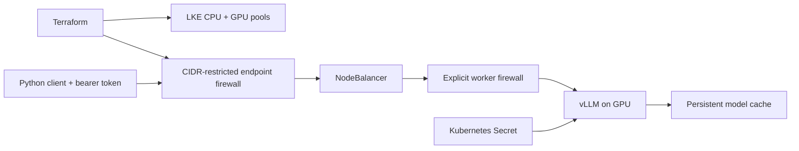

# LKE GPU inference

Run an authenticated, OpenAI-compatible vLLM endpoint on a GPU node in
Linode Kubernetes Engine. Terraform creates separate CPU and GPU pools,
explicit worker and endpoint firewalls, and a control-plane access list. Kubernetes
places Qwen2.5-7B on the GPU, stores model downloads on a persistent volume,
and exposes the service through a NodeBalancer with its firewall attached
at creation. Python clients support complete and streamed responses.



## Code map

| File | Responsibility |
| --- | --- |
| `terraform/main.tf` | Provider requirement, LKE pools, both firewalls, API ACL, and outputs. |
| `terraform/variables.tf` | Cluster, GPU plan, supported Kubernetes version, and trusted CIDR inputs. |
| `terraform/terraform.tfvars.example` | Non-secret example values; replace the documentation-only address. |
| `terraform/.terraform.lock.hcl` | Provider checksums generated by `terraform init`; keeps provider selection reproducible. |
| `manifests/stack.yaml.template` | Namespace, retained PVC, GPU vLLM Deployment, firewall-bound LoadBalancer, and ingress policy. |
| `render.py` | Inserts a validated firewall ID into the manifest before Service creation. |
| `client.py` | Standard-library HTTP and SSE client with bearer authentication. |
| `tests/test_stack.py` | Loopback OpenAI contract tests and deployment manifest invariants. |
| `requirements.txt` | YAML parser used by rendering and manifest validation. |

## Local validation

Python 3.10+ and Terraform 1.5+ are required. These commands create no cloud resources:

```sh
python -m pip install -r requirements.txt
python -m unittest discover -s tests -v
terraform -chdir=terraform init -backend=false
terraform -chdir=terraform validate
terraform -chdir=terraform fmt -check
python render.py --firewall-id 123
```

The tests exercise a local HTTP fixture, including SSE, rejected credentials,
GPU scheduling, secret references, and firewall binding. They do not load a
real model or contact a cloud API.

## Provision and serve

Actual provisioning is a separate, explicit operation and incurs cloud costs.
Use a region/plan with available GPU capacity, a currently supported Kubernetes
version (`linode-cli lke versions-list`), and your own public IPv4 CIDR.
Keep `LINODE_TOKEN` in the environment and Terraform state private.

```sh
cp terraform/terraform.tfvars.example terraform/terraform.tfvars
# Edit the version and client CIDR before continuing.
export LINODE_TOKEN='<your Linode API token>'
terraform -chdir=terraform apply
terraform -chdir=terraform output -raw kubeconfig > kubeconfig
export KUBECONFIG="$PWD/kubeconfig"

helm repo add nvidia https://helm.ngc.nvidia.com/nvidia
helm repo update
helm upgrade --install gpu-operator nvidia/gpu-operator --namespace gpu-operator --create-namespace --wait
kubectl wait nodes --all --for=condition=Ready --timeout=600s
# Confirm a GPU node advertises nvidia.com/gpu before applying the workload.
kubectl get nodes -o custom-columns=NAME:.metadata.name,GPU:.status.allocatable.nvidia\\.com/gpu

kubectl create namespace inference
export VLLM_API_KEY="$(openssl rand -hex 32)"
kubectl -n inference create secret generic inference-token --from-literal=VLLM_API_KEY="$VLLM_API_KEY"
python render.py --firewall-id "$(terraform -chdir=terraform output -raw endpoint_firewall_id)"
kubectl apply -f rendered/stack.yaml
kubectl -n inference rollout status deployment/inference --timeout=1200s
kubectl -n inference get service inference
export VLLM_ENDPOINT='http://<NodeBalancer-IP>'
python client.py 'Explain KV caching briefly.' --stream
```

Both node pools reference an explicit worker firewall from creation, including
new or recycled pool nodes. It accepts private cluster TCP/UDP and IPENCAP
traffic, and NodePort traffic only from the NodeBalancer private subnet
`192.168.255.0/24`; its default inbound policy drops public NodePort access.
The separate endpoint firewall allows only the chosen client CIDR to the
NodeBalancer. This example exposes HTTP inside that restricted boundary;
configure TLS termination before using it across untrusted networks. The
startup probe tolerates an initial model download; `Recreate` avoids two pods
competing for the single GPU and ReadWriteOnce volume.

The RTX 4000 Ada plan has **20 GB** VRAM. This workload uses the reference's
bounded serving settings: an 8,192-token context cap and eight admitted
sequences, with vLLM's GPU memory budget explicitly capped at 90%. It does
not request Qwen's full advertised context window. vLLM sizes the shared KV
pool from memory remaining after weights and runtime profiling; eight
admitted sequences do not reserve eight complete context windows. Actual
GPU loading, capacity, and throughput still require validation on the target
hardware and were not verified by the local contract tests.

To remove the deployment, delete `rendered/stack.yaml` with `kubectl delete -f`,
then run `terraform -chdir=terraform destroy`. The retained block volume may
need explicit removal after you decide whether to keep the model cache.

## References

- [GPU serving reference application](https://github.com/akamai-developers/vllm-on-lke)
- [Linode LKE Terraform resource](https://registry.terraform.io/providers/linode/linode/latest/docs/resources/lke_cluster)
- [Official LKE network and firewall rules](https://techdocs.akamai.com/cloud-computing/docs/lke-network-firewall-details)
- [GPU compute plan specifications](https://techdocs.akamai.com/cloud-computing/docs/compute-instance-plan-types)
- [vLLM OpenAI-compatible server](https://docs.vllm.ai/en/latest/serving/openai_compatible_server/)

This project independently implements the documented deployment pattern; it
does not vendor the reference application's source.
